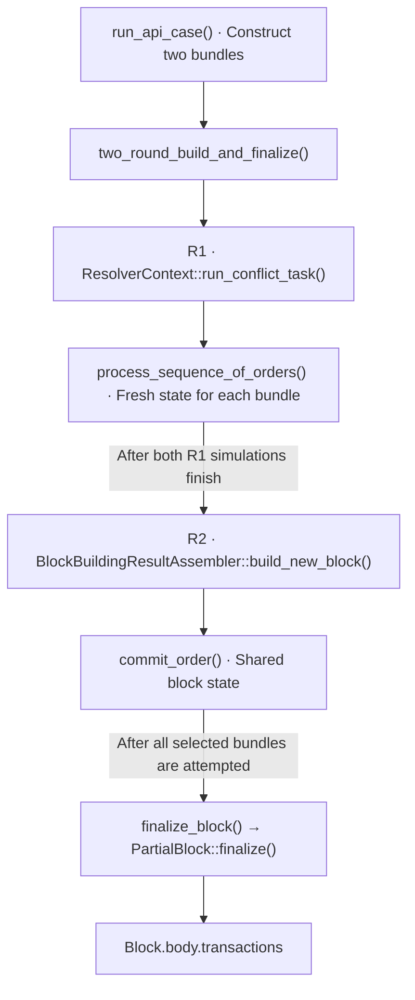

## Two-round bundle execution

`main.rs` takes two bundles, `[tx101, tx102]` and `[tx103, tx104]`, and returns the transaction IDs in the finalized block. It runs both rounds on one thread. R1 evaluates each bundle against a separate copy of the initial state. R2 re-executes the bundles that passed R1 against a shared block state.

### Function flow

### Inputs

In the KLEE build, `main()` creates four sets of symbolic transaction inputs. `make_api_tx()` converts them into transaction fields. The core configuration varies the nonce, sender, transfer value, recipient, and success or revert outcome for each transaction. 

### R1: Simulate each bundle independently

`process_sequence_of_orders()` creates a fresh `BlockState` and `PartialBlock` for each call. The two transactions within a bundle execute in order, so the second sees any state changes made by the first. The resulting `ResolutionResult` records accepted orders and their simulated profits. 

### R2: Re-execute accepted bundles

`build_new_block()` creates one fresh block state, sorts the R1 results by descending profit, and calls `commit_order()` for each accepted bundle. Equal-profit bundles retain their input order. Each committed bundle changes the state used by later bundles.

Both rounds use `execute_evm()`. That function uses REVM-derived validation for checks such as nonce and balance.

### Finalization and output

`PartialBlock::finalize()` reads the R2 candidate’s `executed_tx_infos` and copies those transactions into `Block.body.transactions`. The program prints round-specific rejection messages and the final list of included transaction IDs.
